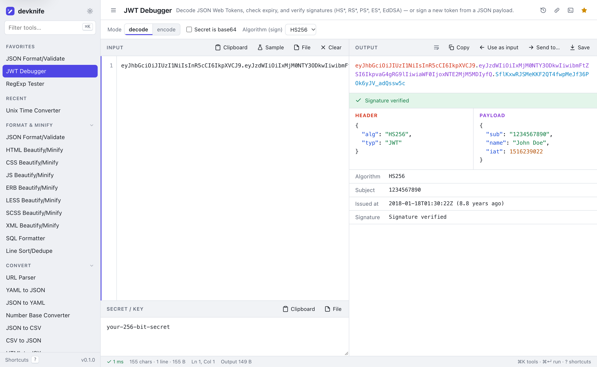

# devknife

**An offline developer toolbox as a native desktop app.** 46 everyday tools (formatters, converters, encoders, decoders, generators, inspectors and a library of handy shell commands) compiled into one Go binary that is also a pipe-friendly CLI and an MCP server for AI agents.

Nothing you paste leaves your machine: no network requests, no telemetry, no account.

<picture>
  <source media="(prefers-color-scheme: dark)" srcset="docs/screenshot-dark.png">
  
</picture>

## Highlights

- **One binary, three ways in.** A native window (system WebView, not Electron), a CLI that fits in pipes, and an MCP server that gives AI agents the same tools.
- **Smart paste.** Paste a JWT, a timestamp, a cron line, a cURL command, Base64, a color or SQL, and devknife opens the right tool in the right mode.
- **Rich views.** JWT signature checks, highlighted regex matches, side-by-side diffs, color contrast, image and Markdown previews.
- **Shell commands at hand.** Over 80 terminal one-liners with what they do (free a port, list open ports, memory and disk use, big files, Git and Docker fixes), in the right variant for macOS or Linux. Fill in the values, copy and paste. Add your own.
- **Private by design.** Tools are pure functions with no network or file access. Secrets you type are never saved.
- **Small.** About 11 MB, starts instantly, no runtime to install.

## Install

devknife is built from source. You need **Go 1.25.5 or newer** and, for the desktop window, a C toolchain (cgo) plus the platform's WebView. Clone this repository, then follow the steps for your platform.

### macOS (app + CLI)

Install the Xcode Command Line Tools if you don't have them (`xcode-select --install`), then:

```sh
make install      # builds dist/devknife.app, copies it to /Applications,
                  # and links the CLI to /usr/local/bin/devknife
```

Or run `make app` and double-click `dist/devknife.app`. Use `ARCHS="arm64 amd64" make app` for a universal build.

The app is ad-hoc signed, not notarized. A build you made yourself opens normally. If you copy it to another Mac, macOS may block it: allow it under **System Settings → Privacy & Security**, or run `xattr -dr com.apple.quarantine /Applications/devknife.app`.

### Windows

You need a cgo toolchain such as [MSYS2](https://www.msys2.org/) mingw-w64. WebView2 is already part of Windows 10 and 11.

```bat
make windows      :: dist\devknife-app.exe (double-click, no console) + dist\devknife.exe (CLI)
```

### Linux

```sh
sudo apt install libgtk-3-dev libwebkit2gtk-4.0-dev
make linux        # dist/devknife: run `devknife app`, or add a .desktop entry
```

The window needs WebKitGTK 4.0 (Ubuntu 22.04, Debian 12). Distributions that ship only 4.1, such as Ubuntu 24.04, can use the CLI-only build below. Its `devknife app` opens the same UI in your browser.

### CLI only, any platform

```sh
make cli-all      # static binaries for macOS, Linux and Windows in dist/cli/ (no cgo)
```

In these builds, `devknife app` opens the UI in your browser instead of a native window.

## Quick start

```sh
devknife app                    # open the desktop window (or double-click the app)
devknife ui                     # the same UI in your browser
pbpaste | devknife              # detect what's on the clipboard and run the right tool
devknife list                   # every tool
devknife <tool> --help          # options, presets and examples for one tool
```

## The app

- **Smart paste.** Paste anything on the home screen, or anywhere outside a text box. devknife detects what it is and opens the right tool with the right mode. A "Looks like…" banner suggests a better tool when your input fits one.
- **Keyboard-first.** On Windows and Linux, use Ctrl instead of ⌘.

  | Shortcut | Action |
  |---|---|
  | `⌘K` | Command palette for every tool and action |
  | `⌘↵` | Run |
  | `⌘⇧C` | Copy the output |
  | `⌘⇧U` | Use the output as input |
  | `⌘⇧↵` | Send the output to another tool |
  | `⌘D` | Add or remove a favorite |
  | `⌥↑` `⌥↓` | Switch tools |
  | `?` | List all shortcuts |

- **Tool chaining.** "Send to…" suggests tools that fit the current output. For example, Base64 → JSON → JSON to Code.
- **Live output** as you type. Errors show the line and column, with a "Go to line" button.
- **Rich views**:
  - A colored JWT with a signature check
  - Regex matches highlighted, with a table of groups
  - A side-by-side or inline diff with change navigation
  - Color swatches with WCAG contrast
  - Image previews with Save and Copy image
  - Sandboxed HTML and Markdown previews
- **Shell Commands.** Search a library of handy terminal commands, each with a short explanation. Values such as the port are highlighted; type yours below the command and the Copy button copies the filled-in command. Commands that kill or delete something are marked "careful". "New command" and "Customize" save your own, with `{{name}}` or `{{name:default}}` for the values to fill in. devknife only shows and copies commands; it never runs them.
- **Presets** for QR payloads (Wi-Fi, vCard…), common regexes, cron schedules and password recipes.
- **Favorites, recent tools and history.** Each tool remembers its last input and options. Turn off "Remember inputs and history on this device" to stop saving inputs. Secrets (signing keys, HMAC keys, passwords) are never saved.
- **Drop files** to load them. Images go to the image tools, and any file can be hashed.
- **"Use from the terminal"** shows the CLI command that matches your current settings.
- **Light and dark themes**, which follow the system by default.

### Browser mode

`devknife ui [--port 7777] [--no-open]` serves the same UI on `127.0.0.1` and opens it in your browser. The link it prints ends in `?k=…`: that's the access key for the local API. The page stores it for that port and removes it from the address bar. If you open the page without it, devknife asks for the link.

## The CLI

```sh
pbpaste | devknife                      # auto-detect and run the right tool
devknife json -f data.json --sort       # format with sorted keys
devknife json -q '.users[*].email' -f data.json
devknife b64 decode SGVsbG8=
devknife jwt -p                         # decode the JWT on your clipboard
devknife time now + 2d                  # timestamp math
devknife uuid v7 -n 5
devknife hash sha256 release.tar.gz     # hashes the file's contents, like sha256sum
devknife case snake "requestURLDecoderID"
devknife diff old.txt new.txt           # colored unified diff
devknife curl python -p --copy          # cURL → Python, clipboard in and out
devknife qr "https://example.com"       # renders in the terminal; -o qr.png saves it
devknife cron "*/15 9-17 * * MON-FRI" --tz Europe/Paris
devknife detect '1700000000'            # what is this?
devknife cmds kill port                 # find a shell command
devknife cmds kill-port --set port=8080 --copy   # just that command, filled in, on the clipboard
```

| Flag | Meaning |
|---|---|
| `-f, --file PATH` | Read input from a file (`-` means stdin) |
| `-p, --paste` | Read input from the clipboard |
| `-c, --copy` | Copy the result to the clipboard |
| `-o, --output PATH` | Write the result to a file (images are written as binary) |
| `-j, --json` | Print the full result as JSON |
| `--quiet` | Print only the result, without the info table |
| `--open` | Open HTML and Markdown previews in your browser (sandboxed) |
| `-h, --help` | Help for a tool |

How input and output work:
- Input comes from arguments, stdin, `-f FILE` or `-p`. A lone argument that names an existing file is read as that file for tools that take files (`hash`, the image tools), with a note on stderr.
- Generators such as `uuid`, `random` and `lorem` don't read stdin, so they work inside `while read` loops. Pass `-` to read stdin explicitly.
- When output is piped, only the result goes to stdout. The info table, warnings and colors go to the terminal or stderr.
- A single line piped in (`echo x | devknife …`) loses the trailing newline that `echo` adds. Multi-line input, redirected files (`< file`) and `-f file` keep their bytes as they are.

Shell completion: `devknife completion bash|zsh|fish`.

## MCP server for AI agents

devknife speaks the [Model Context Protocol](https://modelcontextprotocol.io) over stdio. Every tool becomes an MCP tool with a JSON schema, plus a `detect` tool, so agents can format, convert, decode, hash and generate locally and deterministically.

Claude Code:

```sh
claude mcp add devknife -- devknife mcp
```

Other clients (for example, Claude Desktop's `claude_desktop_config.json`):

```json
{
  "mcpServers": {
    "devknife": { "command": "devknife", "args": ["mcp"] }
  }
}
```

Calls run concurrently and support cancellation. Each call is limited to 30 seconds and 32 MB of output; use the CLI for bigger jobs.

## Tools

Tools marked ✚ go beyond the usual DevUtils set.

**Format & Minify**

| Tool | CLI | What it does |
|---|---|---|
| JSON Format/Validate | `json`, `json-format`, `jf` | Pretty-print, minify or validate JSON with exact error locations |
| HTML Beautify/Minify | `html`, `html-format` | Beautify or minify HTML |
| CSS Beautify/Minify | `css`, `css-format` | Beautify or minify CSS |
| JS Beautify/Minify | `js`, `javascript`, `js-format` | Beautify or minify JavaScript |
| ERB Beautify/Minify | `erb` | Beautify or minify ERB |
| LESS Beautify/Minify | `less` | Beautify or minify LESS |
| SCSS Beautify/Minify | `scss`, `sass` | Beautify or minify SCSS |
| XML Beautify/Minify | `xml`, `xml-format` | Beautify or minify XML |
| SQL Formatter | `sql`, `sql-format` | Format or compact SQL queries |
| Line Sort/Dedupe | `lines`, `sort`, `dedupe` | Sort, deduplicate, reverse, shuffle and clean up lines of text |

**Convert**

| Tool | CLI | What it does |
|---|---|---|
| URL Parser | `url-parse`, `urlparse`, `query-string` | Break a URL into protocol, credentials, host, port, path, query and fragment |
| YAML to JSON | `yaml2json`, `yaml-to-json`, `y2j` | Convert YAML to JSON, preserving key order |
| JSON to YAML | `json2yaml`, `json-to-yaml`, `j2y` | Convert JSON to YAML, preserving key order |
| Number Base Converter | `base`, `number-base`, `radix` | Convert integers of any size between binary, octal, decimal, hex and any base 2–36 |
| JSON to CSV | `json2csv`, `json-to-csv` | Convert a JSON array of objects to CSV |
| CSV to JSON | `csv2json`, `csv-to-json`, `tsv2json` | Convert CSV or TSV to JSON |
| HTML to JSX | `html2jsx`, `jsx`, `html-to-jsx` | Convert HTML to JSX: `class`→`className`, `for`→`htmlFor`, inline styles to objects, camelCase event handlers, SVG attributes, self-closing void tags, comments, and an optional component wrapper |
| String Case Converter | `case`, `string-case`, `camel` | Convert each line between camelCase, PascalCase, snake_case, CONSTANT_CASE, kebab-case, Title Case and more |
| SVG to CSS | `svg2css`, `svg-to-css`, `svg-data-uri` | Turn SVG markup into a CSS `background-image` data URI (compact URL encoding or Base64), with live preview and optional minification |
| cURL to Code | `curl`, `curl2code`, `curl-to-code` | Turn a curl command (for example Chrome's "Copy as cURL") into Go, Python, JavaScript fetch, axios, Rust, Java, C#, Ruby, Swift or HTTPie code |
| JSON to Code | `json2code`, `json-to-code`, `quicktype` | Generate typed models from JSON: Go structs, TypeScript interfaces, Rust serde, Python dataclasses or Pydantic, Swift Codable, Kotlin, Java records, C# classes or JSON Schema |
| Hex to ASCII | `hex2ascii`, `hex-to-ascii`, `unhex` | Decode hex bytes to text |
| ASCII to Hex | `ascii2hex`, `ascii-to-hex`, `hex-encode` | Encode text (UTF-8) as hex bytes with your choice of separator and prefix |

**Inspect & Debug**

| Tool | CLI | What it does |
|---|---|---|
| Unix Time Converter | `time`, `unixtime`, `timestamp` | Convert Unix timestamps (s/ms/µs/ns auto-detected) and dates in almost any format, with date math such as `now + 2d` |
| JWT Debugger | `jwt`, `jwt-debugger`, `token` | Decode JSON Web Tokens, check expiry, and verify signatures (HS\*, RS\*, PS\*, ES\*, EdDSA), or sign a new token from a JSON payload |
| RegExp Tester | `regex`, `regexp`, `re` | Test regular expressions (Go RE2 syntax) with live match highlighting, capture groups, replace, split and output templates |
| HTML Preview | `html-preview`, `preview` | Render HTML in an isolated sandbox |
| Text Diff Checker | `diff`, `compare`, `textdiff` | Compare two texts by character, word or line |
| String Inspector | `inspect`, `string-inspector`, `count` | Count characters (graphemes, code points, UTF-16 units, bytes), words, lines and sentences; find invisible or look-alike characters; see word frequency or a per-character Unicode breakdown |
| Markdown Preview | `markdown`, `md`, `markdown-preview` | Render GitHub-flavored Markdown (tables, task lists, strikethrough, autolinks, footnotes) and get the HTML |
| Cron Job Parser | `cron`, `crontab`, `cron-parser` | Explain a cron expression in plain English, expand every field, and list the next run times in any time zone |
| Color Converter | `color`, `colour`, `hex` | Convert between HEX, RGB(A), HSL(A), HSB/HSV, HWB, CMYK and CSS named colors |
| JSON Query ✚ | `json-query`, `jq`, `jsonpath` | Extract values from JSON with a path: `.users[0].name`, `users[*].email`, `$..id`, `items[-1]`, `items[1:3]`, `items.length` |

**Generate**

| Tool | CLI | What it does |
|---|---|---|
| UUID/ULID Generate/Decode | `uuid`, `ulid`, `guid` | Generate UUID v1/v3/v4/v5/v6/v7, ULID, Nano ID or MongoDB ObjectID in bulk, or decode one to see its version, variant, embedded timestamp and raw bytes |
| Lorem Ipsum Generator | `lorem`, `lipsum`, `placeholder` | Generate placeholder text as paragraphs, sentences or words, optionally wrapped in `<p>` tags |
| QR Code Reader/Generator | `qr`, `qrcode` | Generate QR codes (PNG, with error-correction level) for text, URLs, Wi-Fi, vCards and more, or read the content of a QR code image |
| Hash Generator | `hash`, `md5`, `sha` | Compute MD5, SHA-1/2/3, BLAKE2b, CRC32 and more for text or files, with an optional HMAC key and hex or Base64 output |
| Random String Generator | `random`, `password`, `rand` | Cryptographically secure random strings, passwords, tokens and PINs |
| Bcrypt Hash/Verify ✚ | `bcrypt`, `password-hash` | Hash a password with bcrypt (configurable cost) or check a password against an existing bcrypt hash |

**Encode & Decode**

| Tool | CLI | What it does |
|---|---|---|
| Base64 String Encode/Decode | `base64`, `b64` | Encode text to Base64 or decode it back |
| Base64 Image Encode/Decode | `base64-image`, `b64img`, `image-base64` | Preview a Base64 string or data URL as an image, or turn an image file into Base64, a data URL, a CSS background or an `` tag |
| URL Encode/Decode | `url`, `urlencode`, `urldecode` | Percent-encode or decode text |
| HTML Entity Encode/Decode | `html-entity`, `entity`, `entities` | Escape text for safe HTML embedding, or decode named (`&nbsp;`), decimal (`&#169;`) and hex (`&#x1F600;`) entities |
| Backslash Escape/Unescape | `backslash`, `escape`, `unescape` | Escape text for string literals (`\n`, `\t`, `\"`, `\\`, `\u0000`) or unescape them, including `\xHH`, `\uXXXX`, `\u{1F600}`, `\UXXXXXXXX` and octal |
| Certificate Decoder (X.509) | `cert`, `x509`, `certificate` | Decode PEM/DER certificates, chains and CSRs: subject, issuer, validity (with days remaining), SANs, key details, extensions and fingerprints, openssl-style |

**Reference**

| Tool | CLI | What it does |
|---|---|---|
| Shell Commands ✚ | `commands`, `cmds`, `shell`, `snippets`, `cheatsheet` | Over 80 handy terminal commands with explanations, for macOS and Linux: kill the process on a port, list open ports, memory, disk and CPU use, big files, search and replace, logs, Git, Docker, SSH and more. Search them, fill in values with `--set port=8080`, or pass an ID such as `kill-port` to print just that command |

## Privacy and security

- All processing happens in-process. Tools are pure functions with no network or file access.
- The UI server listens on `127.0.0.1` only and refuses other addresses. It rejects foreign `Host` and `Origin` headers, which blocks DNS rebinding and CSRF.
- The local API needs an access key, so other users and apps on the machine can't read your history. The desktop app handles it for you; in browser mode, open the link `devknife ui` prints.
- HTML and Markdown previews are served from an opaque, sandboxed origin and can't load anything from the network, so a pasted email can't phone home. Scripts and remote content are off unless you turn them on per tool. `--open` writes the same restrictions into the file it opens.
- In the desktop app, the native helpers (clipboard, save) need a per-launch token, so a preview frame can't call them.
- The JWT debugger reports `alg: none` tokens as unsigned and rejects HS\* tokens "signed" with an RSA or EC public key (algorithm confusion).
- Secrets (signing keys, HMAC keys, bcrypt passwords) are kept in memory only. They're never written to disk, history, URLs or share links.
- Shell Commands only shows and copies commands. devknife never runs them.
- v1 and v6 UUIDs use a random node ID instead of your network card's MAC address.
- Hostile input (deeply nested JSON or markup, YAML alias bombs, huge images, runaway regex replacements) produces an error instead of crashing the app or exhausting memory. The UI stops waiting for a run after 15 seconds and MCP after 30; the CLI has no time limit.

### Reporting a vulnerability

Please report security issues privately through GitHub's **Security → Report a vulnerability** form for this repository rather than in a public issue.

## Where your data lives

| OS | Folder |
|---|---|
| macOS | `~/Library/Application Support/devknife/` |
| Linux | `$XDG_CONFIG_HOME/devknife/` (usually `~/.config/devknife/`) |
| Windows | `%AppData%\devknife\` |

- `ui-state.json` holds favorites, recent tools, theme, per-tool inputs and options, history, and the shell commands you added. `ui-state.json.bak` is the version from before the current session. If the file is ever damaged, devknife sets it aside as `ui-state.json.corrupt` and loads the backup.
- `access-key` is the key for the local API.

To reset devknife, quit it and delete the folder. Previews opened with `--open` are written to a `devknife-previews` folder in your temp directory and deleted after 10 minutes.

## Development

```sh
make build        # bin/devknife with the native window (cgo)
make run          # build and open the desktop window
make test         # tools, detection, CLI, MCP and web API tests
make vet
make vuln         # govulncheck (needs network)
make cli-all      # CGO_ENABLED=0 cross-compiled CLI binaries
go run ./cmd/devknife ui --no-open --port 7791   # browser mode for UI work
```

| Path | Contents |
|---|---|
| `cmd/devknife` | Entry point |
| `internal/core` | Tool model: options, results, registry, smart detection, run limits |
| `internal/tools` | All 46 tools. Each is a pure `Run(Request) (*Result, error)` |
| `internal/web` | Local HTTP API and the embedded UI (vanilla JS, no CDN) |
| `internal/desktop` | Native window (system WebView), macOS menu bar and native bridge |
| `internal/cli` | CLI front end |
| `internal/mcp` | MCP server |
| `scripts/` | macOS packaging and the icon generator |

Adding a tool means writing one function that returns a `*core.Tool` and registering it in `internal/tools/registry.go`. The app, the CLI, `--help`, shell completion and MCP all pick it up automatically. [`CLAUDE.md`](CLAUDE.md) describes the architecture, conventions and gotchas in detail; it doubles as the guide for [Claude Code](https://claude.com/claude-code).

`DEVKNIFE_HOSTILE=1 go test ./internal/tools -run TestEveryToolSurvivesHostileInput` feeds every tool deeply nested input, a 10 MB line and output-amplifying shapes, and fails on a crash or a run that doesn't end. It takes about two minutes, so it isn't part of `make test`; run it after adding a tool or a parser.

## Contributing

Issues and pull requests are welcome. For a new tool, please open an issue first to discuss it.

- Tools must stay pure: no network or filesystem access. The UI and the MCP server pass them untrusted input.
- Recursive parsers need a depth limit, and code that writes indentation must call `core.CheckOutput` (see "Hostile input" in `CLAUDE.md`).
- Keep CLI output pipe-clean: only the result goes to stdout.
- To add a shell command, add an entry to `shellCmds` in `internal/tools/commands.go`, with a macOS and a Linux variant when they differ. Give every `{{placeholder}}` a default and set `Danger` on anything that kills or deletes. `make test` checks that each command parses as shell.
- Run `make vet test` before sending a change.
- PHP-specific tools are out of scope.

## Acknowledgements

devknife is inspired by [DevUtils](https://devutils.com). It's built on:
- [webview/webview_go](https://github.com/webview/webview_go) for the native window
- [yuin/goldmark](https://github.com/yuin/goldmark) for Markdown
- [tdewolff/minify](https://github.com/tdewolff/minify) for minification
- [go-yaml/yaml](https://github.com/go-yaml/yaml) for YAML
- [makiuchi-d/gozxing](https://github.com/makiuchi-d/gozxing) and [skip2/go-qrcode](https://github.com/skip2/go-qrcode) for QR codes
- [google/uuid](https://github.com/google/uuid) and [oklog/ulid](https://github.com/oklog/ulid) for IDs
- [sergi/go-diff](https://github.com/sergi/go-diff) for diffs
- [golang.org/x/crypto](https://pkg.go.dev/golang.org/x/crypto) and [golang.org/x/image](https://pkg.go.dev/golang.org/x/image) from the Go team

## License

[MIT](LICENSE)
